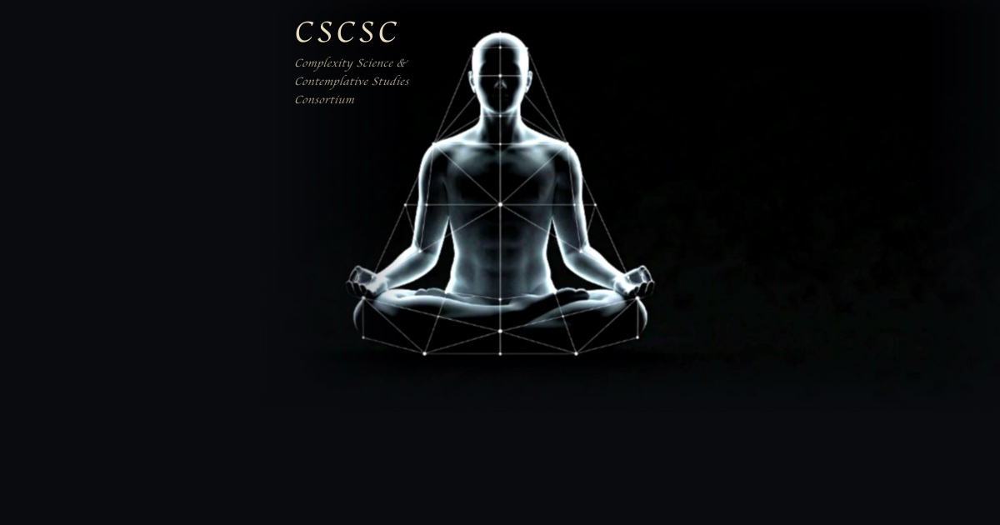

**Start here — our vision in 3 minutes.** A short animation for what this is all about — no background needed.

[Watch our animation](/vision/)

> **Complexity science: the study of how simple parts can do smart things together without anyone in charge  – from proteins, to organisms, to societies and minds.**

*CSCSC asks what this rigorous science of self-organization can learn from — and offer back to — contemplative traditions.*

<aside class="note">

[**Our Language**](/learn/glossary/) defines how we think.

[Best place to start learning:](/learn/glossary/) look through this map of terms we curated. The terms that feel unfamiliar are your personalized map of what to learn to dive into the dialogue.

</aside>

---

## <u>Choose</u> <u>your path</u>

### **However much time you've got, there's a way in.** Every path below has a 5-minute spark, an afternoon, and a weekend deep-dive — pick your depth and dive.

[New to complexity?](/learn/new-to-complexity/)

Intro or deepen into the profound insights of **complex systems science** – through videos, interactive animations and further reading

[Why contemplation?](/learn/why-contemplation/)

The trouble with the common scientific episteme – and how rigorously engaging it forces us to look beyond.

[Already in the conversation?](/learn/already-in-the-conversation/)

Dive deeper into concrete references, readings and videos best representing what we're doing and thinking about.

---

**A bit more about our vision** — two ways in, pick your depth:

### Conference talk · 12 min

An accessible overview of how complexity science meets Eastern philosophy — the gentler entry point. Pairs with our [accompanying Psyche magazine publication](https://psyche.co/ideas/complexity-science-unravels-the-deeper-power-of-mindfulness).

<iframe src="https://www.youtube-nocookie.com/embed/ivw4H5GvF_I" title="Eastern Philosophy and Complexity Science · Pavel Chvykov" loading="lazy" allow="accelerometer; encrypted-media; gyroscope; picture-in-picture" allowfullscreen></iframe>

Eastern Philosophy and Complexity Science · Pavel Chvykov

### Podcast · 58 min

A deeper, more technical conversation with Francis Heylighen — consciousness, autopoiesis, cybernetics and phenomenology, right in the space of questions we sit with.

<iframe src="https://www.youtube-nocookie.com/embed/FMFmv9SU7JM" title="Francis Heylighen - Science and Contemplation (Ep. 1)" loading="lazy" allow="accelerometer; encrypted-media; gyroscope; picture-in-picture" allowfullscreen></iframe>

Francis Heylighen - Science and Contemplation (Ep. 1)

[**Stay in touch**](https://cscsc.notion.site/286d8cae0cfe8031833ac1a301824aa0?pvs=105) *for updates*

<a class="page-link" href="/learn/new-to-complexity/">New to complexity?</a>

<a class="page-link" href="/learn/why-contemplation/">Why contemplation?</a>

<a class="page-link" href="/learn/already-in-the-conversation/">Already in the conversation</a>
